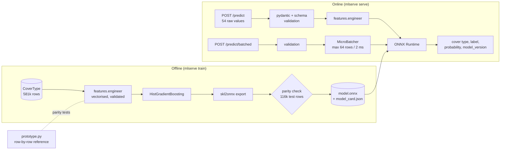

# mlserve: from notebook prototype to a measured production model service

A forest cover-type classifier taken the way an ML team usually has to take one: from a
row-by-row notebook prototype to a service you can put behind a load balancer. The
prototype is kept in the repo as the specification; the production path is vectorised and
validated feature engineering, a gradient-boosted model exported to ONNX with a parity
check, a model card, and a FastAPI service with a direct endpoint and a micro-batched one.
Every speed-up and every quality number below was measured on this repo's code.

Data: the UCI **Forest CoverType** dataset (Blackard, 1998): 581,012 cells of 30 x 30 m in
the Roosevelt National Forest, 54 cartographic columns (10 numeric, 4 one-hot wilderness
areas, 40 one-hot soil types), 7 cover types. It is downloaded through
`sklearn.datasets.fetch_covtype` on first use; nothing is committed.

## Results

Measured on one Windows 11 laptop (12 logical cores), Python 3.12, scikit-learn 1.9.1,
ONNX Runtime 1.32.0. Stratified 80/20 split, seed 0: 464,809 training rows, 116,203 test rows.
Full tables: [`reports/results.md`](reports/results.md), raw numbers in `reports/*.json`.

### Model quality (test set)

| Model | Accuracy % | Macro-F1 % |
|---|---|---|
| Logistic regression on the same engineered features | 71.42 | 50.19 |
| HistGradientBoosting, 200 iterations (scikit-learn) | **97.35** | **95.13** |
| Same model exported to ONNX Runtime | **97.35** | **95.13** |

ONNX parity on all 116,203 test rows: 100.000 % label agreement, max absolute probability
difference 3.7e-06. ONNX file 27.3 MB, training time 75 s.

### Prototype vs production code

| Step | Prototype (row by row) | Production | Speed-up |
|---|---|---|---|
| Feature engineering, rows/s | 3,466 | 1,187,867 | 343x |
| One prediction from a raw row, ms | 73.1 | 0.66 | 111x |

The vectorised features match the prototype to a max relative difference of 5.7e-08
(float32 rounding), checked by a test.

### scikit-learn vs ONNX Runtime (same model)

| Mode | scikit-learn | ONNX Runtime (1 thread) |
|---|---|---|
| Batch of 1, median ms | 70.8 | **0.18** |
| Bulk, 116,203 rows, rows/s | **21,187** | 8,028 |

ONNX wins by ~390x on single-row latency, which is what an online API does; scikit-learn's
multi-threaded bulk prediction is 2.6x faster than single-threaded ONNX Runtime for offline
scoring. Use the right runtime for each job.

### HTTP API under load

uvicorn with 1 worker in its own process; closed-loop load from N threads with keep-alive
clients on the same machine; 1,000 requests per run.

| Endpoint | Concurrency | Throughput (req/s) | p50 ms | p95 ms | p99 ms | Mean batch | Max batch |
|---|---|---|---|---|---|---|---|
| `/predict` | 1 | **209** | **4.5** | 5.6 | 6.2 | 1.0 | 1 |
| `/predict` | 8 | 250 | 26.6 | 37.1 | 42.7 | 1.0 | 1 |
| `/predict` | 32 | 167 | 105.6 | 124.6 | 152.5 | 1.0 | 1 |
| `/predict/batched` | 1 | 62 | 15.7 | 20.1 | 22.4 | 1.0 | 1 |
| `/predict/batched` | 8 | **293** | **21.8** | 28.1 | 30.1 | 2.6 | 7 |
| `/predict/batched` | 32 | **210** | **60.5** | 90.6 | 106.1 | 7.1 | 22 |

What this shows:
- Micro-batching pays off under concurrency: +17 % throughput and -18 % p50 at 8 clients,
  +26 % throughput and -43 % p50 at 32 clients, as requests get grouped (up to 22 per ONNX call).
- It costs latency when traffic is light: at 1 client, every request waits for the batching
  window. The window is 2 ms, but the measured cost is ~11 ms because asyncio timers on
  Windows have ~15.6 ms resolution. On Linux the penalty should be close to the configured
  2 ms (not measured here). Pick the endpoint, or the window, from the expected traffic.
- An earlier version of this benchmark ran the server in the same process as an asyncio
  httpx client. The client turned out to be the bottleneck (it serialised requests and added
  ~7 ms each), so the batcher never saw concurrent traffic. Measuring the load generator is
  part of measuring the service.

## Architecture



- `src/mlserve/prototype.py`: the notebook-style reference implementation (correct, readable,
  slow). It is the spec: tests check the production features against it.
- `src/mlserve/features.py`: schema validation (shape, finite values, ranges, one-hot blocks)
  and vectorised feature engineering (19 features: aspect as sin/cos, hydrology distance,
  elevation offsets, road/fire combinations, hillshade mean, wilderness and soil ids).
- `src/mlserve/model.py`: training, linear baseline, ONNX export, parity check, model card
  (versions, features, metrics), and the ONNX `Predictor`.
- `src/mlserve/api.py`: FastAPI app with `/predict`, `/predict/batched`, `/health`, `/stats`.
- `src/mlserve/bench.py`: feature, inference and HTTP load benchmarks.
- `src/mlserve/cli.py`: `mlserve train | bench | report | serve`.

## How to run

```bash
python -m venv .venv && source .venv/bin/activate   # Windows: .venv\Scripts\activate
pip install -e ".[dev]"

mlserve train      # downloads CoverType (~11 MB), trains, exports ONNX, parity check, model card
mlserve bench      # feature, inference and API benchmarks -> reports/bench.json
mlserve report     # renders reports/results.md
mlserve serve --port 8000

curl -X POST localhost:8000/predict -H "content-type: application/json" \
     -d '{"values": [2596, 51, 3, 258, 0, 510, 221, 232, 148, 6279, 1, 0, 0, 0, 0, 0, 0, 0, 0, 0, 0, 0, 0, 0, 0, 0, 0, 0, 0, 0, 0, 0, 0, 0, 0, 0, 0, 0, 0, 0, 0, 0, 0, 0, 0, 0, 0, 0, 0, 0, 1, 0, 0, 0]}'
```

Tests and lint (no download needed: tests use synthetic rows with the real schema):

```bash
ruff check . && ruff format --check .
pytest -q
mlserve train --synthetic --artifacts ci-artifacts --reports ci-reports   # what CI runs
```

GitHub Actions runs ruff, the 10 tests on Python 3.10 and 3.12, and a synthetic end-to-end
smoke run of `train` and `bench`.

## Limitations

- One dataset, one model family, one machine. The latency and throughput numbers are from a
  Windows laptop with the load generator on the same machine; they show relative effects
  (prototype vs production, direct vs batched), not capacity planning figures.
- The micro-batching window and size (2 ms, 64 rows) were not tuned; neither were ONNX
  Runtime thread settings (1 thread) or the number of uvicorn workers.
- The 27 MB ONNX file and the 39 MB joblib model are not committed; `mlserve train`
  rebuilds them (75 s on this machine).
- CoverType's split is random, not spatial: neighbouring cells can land in train and test,
  so 97 % accuracy is optimistic for a new region.
- No drift monitoring or model registry here; see `elec2-drift-mlops` for that side.

## En bref (FR)

Industrialisation d'un modèle de classification (jeu de données public UCI CoverType,
581 012 parcelles, 7 essences) : le prototype « notebook » ligne à ligne est conservé comme
référence, puis remplacé par un feature engineering vectorisé et validé (343x plus rapide),
un modèle HistGradientBoosting (97,35 % d'exactitude, macro-F1 95,13 % contre 71,4 % pour une
régression logistique) exporté en ONNX avec contrôle de parité (100 % d'accord sur 116 203
lignes), une fiche modèle, et une API FastAPI avec un endpoint direct et un endpoint à
micro-batching. Mesures : une prédiction passe de 73 ms à 0,66 ms ; sous 32 clients
simultanés, le micro-batching augmente le débit de 26 % et réduit la latence médiane de 43 %,
mais il la dégrade à faible charge. Tests pytest, ruff et CI GitHub Actions.

## License

MIT, see [LICENSE](LICENSE).
